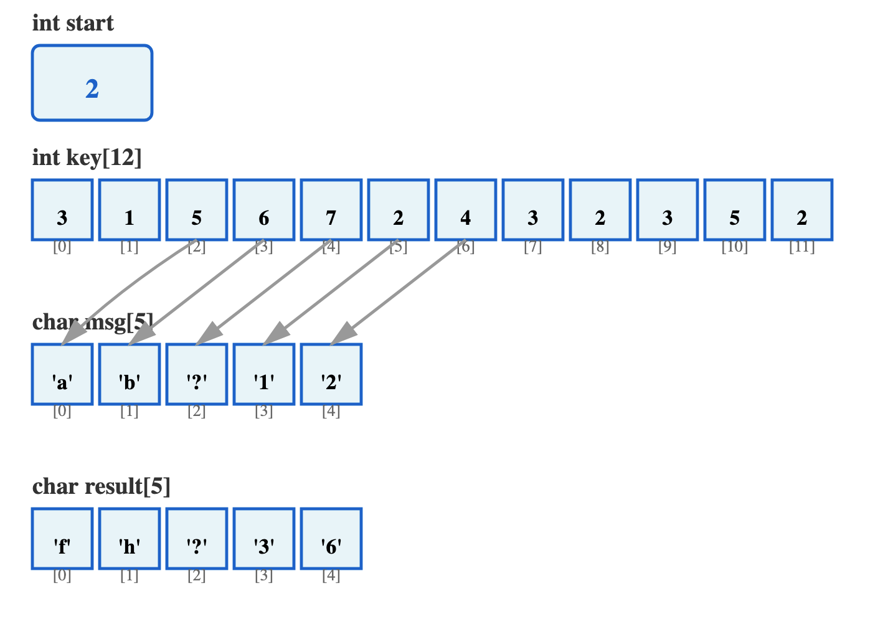
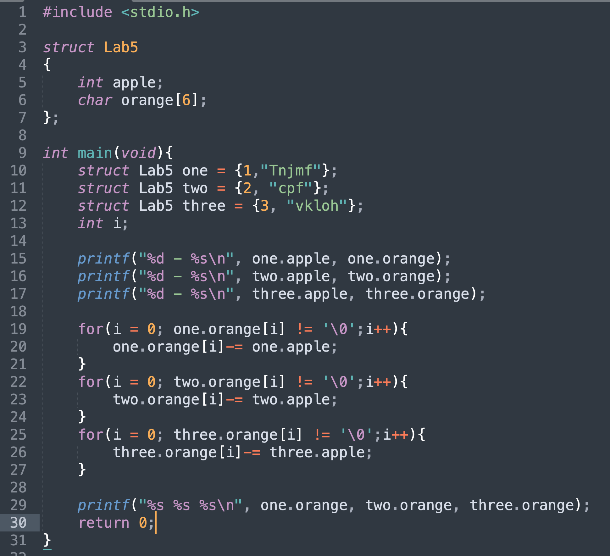

# Lab 5

This lab is worth 1.25% of your final grade

## Due Date

* End of lab period in week 8

## What you need to do (by the end of the lab class) 

* Quiz: Record your answers to the in-class quiz on the paper provided to you
* Code: Update your PRIVATE GitHub ipc144 repository:
	* With the solutions to the assigned lab work even if it is not fully functional or completed
	* Submit the code using matrix submitter
	* Submit the URL to your private ipc144 GitHub repository on Blackboard
 

## Objectives

* Practice writing functions involving arrays and C strings
* Practice writing a program involving arrays and C strings

## To have the best possible outcome for lab 5

* Prior to lab, complete all the reading listed for week 6 and 8 in your Weekly Content item on blackboard. Please read the entire chapter.  Link repeated below
    * [Arrays and C strings](https://seneca-scpa.github.io/Introduction-To-Programming/H-Arrays/intro)


## Lab Preparation

To submit your work for this lab, **YOU MUST HAVE SUCCESSFULLY COMPLETED [Lab-0](../lab0/README.md)** where you configure the tooling and learn the process involved in completing a lab and how to submit your work!

---

## Quiz Part-1

```
   ___        _          ____            _        _ 
  / _ \ _   _(_)____    |  _ \ __ _ _ __| |_     / |
 | | | | | | | |_  /    | |_) / _` | '__| __|____| |
 | |_| | |_| | |/ /     |  __/ (_| | |  | ||_____| |
  \__\_\\__,_|_/___|    |_|   \__,_|_|   \__|    |_|
```


* Part-1 of quiz is based on the reading material for week 6-8 (Chapters on arrays, C string)
* Your professor will provide you with a piece of paper and project the lab quiz on the lab screen.
* Provide the answer to the questions on your paper.  You only need to number the question and write down the answer.  No need to copy the question.

---

## Programming Problem Overview

In this lab you will write a "secret message" creator.  The program will provide the user with 2 options:

* create a secret message
* decode a secret message

In both cases the program will read in a message string from the user and display the output of the create/decode result.  The option to `create` will scramble the message making it unreadable while the option to `decode` will unscramble the message making it readable.

You may assume the user will not enter more than 200 characters for the message, but this limit should be programmed in a way that makes it easy to modify without having to make many changes to the code.

### Scramble Process

Refer to the starter code in **lab5main.c** to see the referenced `secretKey` array.

* The main function contains a secret key (`int secretKey[KEYCAP]={...}`) in the form of an array of integers (you can assume all values will be positive).  The numbers in the array are used to shift the alphabetic and numeric characters in the message string. This applies to both the scrambling and unscrambling processes.
* To ensure the same secret key is not always used, properties from the message string are used to determine a starting position (index) in the secretKey array.
* The secretKey array starting position (index) is determined by getting a count of the number of alphabetic characters in the message string (either upper or lower case)
* Scrambling process:
    * Evaluate each character of the message string and adjust each character according to the following rules:
        * Non-alphabetic, non-numeric characters are not modified.
        * Alphabetic character:
            - **Add** to the character the secretKey number which is the element at the corresponding index (relative to the starting index)
            - When the resulting character exceeds 'z' or 'Z', it should circle back and continue from the start of the alphabet.
        * Numeric character:
            - **Add** to the digit character the secretKey number which is the element at the corresponding index (relative to the starting index)
            - When the resulting digit character exceeds '9', it should circle back and continue from the '0' digit character.
        * here is an example:

            

    * Lastly, **`reverse`** the character string

### Unscramble Process

* Unscrambling a message string is only possible if the message string was originally scrambled using the above described algorithm. To unscramble a scrambled message string, it is a matter of reversing the scramble process:
    - Reverse the message string
    - Determine the start index position for the secretKey array
    - Non-alphabetic and non-numeric characters are left alone and not modified
    - **Subtract** from the character (or digit character) the corresponding secret key element number (relative to the starting index) circling back as requried to then end of the  'z' or 'Z' sequence when it's an alphabetic character or circling back from '9' when it's a digit character.

**DISCLAIMER:** The methods used to scramble/unscramble messages described in this lab are known to be **breakable** and are not to be used in any official or important encryption process.

## Program Breakdown

To complete this program, you will need to implement a number of functions and call them to complete the implementation.  Below, are a listing of all the functions that you must implement along 

### Function 1

```c
int countAlpha(const char message[]);
```

This function is passed `message`, a null terminated character string.  It will return the number of alphabetic characters in `message`.  

---

### Function 2

```c
int numChars(const char message[]);
```

This function is passed `message`, a null terminated character string.  It will return the number of characters in `message` before `'\0'` (the null character)

### Function 3

```c
void reverse(char message[]);
```

This function is passed `message`, a null terminated character string. The function will reverse the characters in the string.

Example:

```c
char msg[6] = "hello";
reverse(msg); //msg will become "olleh"
```

**Hint:** One way to reverse a string is to swap characters: the first/last, second/second last, etc. do this all the way to the middle of the string and all string will be reversed.

### Function 4

```c
char encode(char ch, int key);
```

This is passed a character and a key value.  It applies the encoding rule:

* if `ch` is alphabetic, **add** `key` to `ch` but will circle back to 'a' if it goes past 'z'

```
ch = 'a', key = 2 --> returns 'c'
ch = 'z', key = 2 --> returns 'b' because 'z' + 2 go pass z so we go back to start of the alphabet. 
ch = 'Y', key = 2 --> returns 'A' again, we are going around if needed.
```

* if `ch` is numeric, **add** `key` to `ch` but will circle back to '0' if it goes past '9'

```
ch = '5', key = 2 --> returns '7'
ch = '7', key = 4 --> returns '1'
```

**Hint:**
There are different ways to do this:
- Option-A:
    - Use selection (`if...` statements) to determine if you go past end of the character group ('z', 'Z', '9'), then determine how much you have gone past and add that to the starting character of the character group ('a', 'A' , '0').
- Option-B:
    - Apply a purely mathematical approach using **modulus**, and **addition/subtraction**.

### Function 5

```c
char decode(char ch, int key);
```

This function applies the decoding rule to `ch` by **subtracting** the `key` from `ch` and circling back from 'z'/'Z' if it goes past the 'a'/'A' character.

Examples:
* if `ch` is alphabetic, **subtract** `key` from `ch` but circle back from 'z'/'Z' if it goes past 'a'/'A'

```
ch = 'z', key = 2 --> returns 'x'
ch = 'a', key = 2 --> returns 'y' because 'a' - 2 goes pass 'a' so we circle back from 'z'. 
ch = 'b', key = 2 --> returns 'z' again, requires circling back from 'z'.
```

* if `ch` is numeric, **subtract** `key` from `ch` but circle back from '9' if it goes past '0'

```
ch = '5', key = 2 --> returns '3'
ch = '4', key = 7 --> returns '7'
```

### Function 6

```c
void scramble(char message[], const int key[], int start);
```

This function encodes the message by:

- encoding each letter of message with an element of the key array. 
    * The first character of message is encoded with `key[start]`
    * The second character of message is encoded with `key[start + 1]`
    * The third character of message is encoded with `key[start + 2]` etc.
- **reverse** the message

### Function 7

```c
void unscramble(char message[], const int key[], int start);
```

This function decodes the message:

* reverse the message to the original sequence
* decode each letter of message with the appropriate element from the `key` array. 
    * The first character of message is decoded with key[start]
    * The second character of message is decoded with key[start + 1]
    * The third character of message is decoded with key[start + 2] etc.

### Provided Character String Input Helper Function

```c
void readMessage(char message[],int max);
```

This function will read and store user entered text to the `message` character array up to `max` characters or newline whichever is encountered first.  It cleans up the input buffer to ensure future reads \(inputs\) continue to work as expected.

**NOTE:** This function is provided in lab5.h/lab5.c and therefore you do not need to write it! However, you must use it where appropriate in your program.

---

```
  ____                                 _             _   _             
 |  _ \  ___ _ __ ___   ___  _ __  ___| |_ _ __ __ _| |_(_) ___  _ __  
 | | | |/ _ \ '_ ` _ \ / _ \| '_ \/ __| __| '__/ _` | __| |/ _ \| '_ \ 
 | |_| |  __/ | | | | | (_) | | | \__ \ |_| | | (_| | |_| | (_) | | | |
 |____/ \___|_| |_| |_|\___/|_| |_|___/\__|_|  \__,_|\__|_|\___/|_| |_|
                                                                       
```

## Getting Started: Demo

Your professor will:
* Briefly discuss:
    - What the **input buffer** is and...
    - How we manage the input buffer (using the provided **`readMessage`** function as a reference) 
* How to write Function 1
* How to call the function from the main function
* How to determine the secretKey starting index

---

```
  ___ _   _      __   __                 _____                         
 |_ _| |_( )___  \ \ / /__  _   _ _ __  |_   _|   _ _ __ _ __          
  | || __|// __|  \ V / _ \| | | | '__|   | || | | | '__| '_ \         
  | || |_  \__ \   | | (_) | |_| | |      | || |_| | |  | | | |  _ _ _ 
 |___|\__| |___/   |_|\___/ \__,_|_|      |_| \__,_|_|  |_| |_| (_|_|_)
                                                                       
```

### Program the Functions

Code all the remaining functions described above and test each one as you complete them. 

- **lab5.h** : Function PROTOTYPES with **DOCUMENTATION for each function**
- **lab5.c** : Function DEFINITIONS
- **lab5main.c** : 
    - **Testing**: Testing your function during the development of the solution
    - **Assembly**: Replace all testing code from your development phase with the program solution. This will assemble and implement those functions as required. See the next section.

---


### Program Assembly:

Your program will:

* Print this banner at start of program:
```
IPC Secret Message Machine
==========================
```
* Ask user if they wish to encode or decode a message using a menu system:
```
1. Encode a message
2. Decode a message
0. QUIT

Choice: 
```
* The input must be validated using methods previously discussed.  If user enters invalid information, be sure to ask them to re-enter.
    * the process of doing this has been done many times in the past.  You can look back to your previous labs on how to do this.  Ensure that user enters either a 0, 1, or a 2 value
    * If the entered choice is `0`, allow the program to end gracefully

* Ask user to enter their message:

```
Enter message:
```

* Perform scramble/unscramble as appropriate:
* Print one of the following depending on whether you are encoding or decoding:

```
Encoded message:
```
or
```
Decoded message:
```

* Print the resulting text

* Repeat with the menu option until the user chooses `0` to QUIT

---

#### Sample Execution 1:

Sample showing valid menu options with encoding and decoding.

```
IPC Secret Message Machine
==========================
1. Encode a message
2. Decode a message
0. QUIT

Choice: 1
Enter message: r2d2 and C3PO or is it C3P0? The quick brown fox jumped over the lazy dog. THIS IS A SECRET! shhhhhhhhhh.
Encoded Message: .nohpoihonpz !ZFRKGU G XP VLNU .osi zffr gna rfws kkqtzj yug vevyg qhkzt eiB ?2P6C zp yp zr OX9H hnh 4i2w

IPC Secret Message Machine
==========================
1. Encode a message
2. Decode a message
0. QUIT

Choice: 2
Enter message: .nohpoihonpz !ZFRKGU G XP VLNU .osi zffr gna rfws kkqtzj yug vevyg qhkzt eiB ?2P6C zp yp zr OX9H hnh 4i2w
Decoded Message: r2d2 and C3PO or is it C3P0? The quick brown fox jumped over the lazy dog. THIS IS A SECRET! shhhhhhhhhh.

IPC Secret Message Machine
==========================
1. Encode a message
2. Decode a message
0. QUIT

Choice: 0
```

#### Sample Execution 2:

Sample showing menu validation rules.

```
IPC Secret Message Machine
==========================
1. Encode a message
2. Decode a message
0. QUIT

Choice: -1
Invalid choice: Enter 0, 1, or 2.

IPC Secret Message Machine
==========================
1. Encode a message
2. Decode a message
0. QUIT

Choice: 3
Invalid choice: Enter 0, 1, or 2.

IPC Secret Message Machine
==========================
1. Encode a message
2. Decode a message
0. QUIT

Choice: 2
Enter message: !znrlzwx D ivmyy 7# ccm 452CXJ up ainZ
Decoded message: This is IPC144 lab #5 using C strings!

IPC Secret Message Machine
==========================
1. Encode a message
2. Decode a message
0. QUIT

Choice: 0
```

---

## Submission Instructions:

```
  ____        _               _         _             
 / ___| _   _| |__  _ __ ___ (_)___ ___(_) ___  _ __  
 \___ \| | | | '_ \| '_ ` _ \| / __/ __| |/ _ \| '_ \ 
  ___) | |_| | |_) | | | | | | \__ \__ \ | (_) | | | |
 |____/ \__,_|_.__/|_| |_| |_|_|___/___/_|\___/|_| |_|
                                                      
```

* Submit your code (solution to the programming problem)

	- Update your GitHub PRIVATE ipc144 repository with your solution to the programming problem:
		- Here is an EASY [guide on how to push code from Visual Studio Code and Visual Studio](../gitinstructions/gitpush.md)
		- If you are not using the above IDE's, manually perform the 3-git commands (from anywhere within your repository directory structure):
			```
			git add -A
			git commit -am "Completed lab5"
			git push origin main
			```

	- Connect to **matrix**: 
		- Open a command prompt (or terminal) window
		- Type the following connection command and substitute `loginName` with YOUR Seneca login name!
		```
		SSH loginName@matrix.senecapolytechnic.ca
		```
	- Change to the directory where you cloned your ipc144 repository (use the `cd` command accordingly)
	- Update the matrix copy of your PRIVATE ipc144 GitHub repository:
		```
		git pull origin main
		```
	- Change to the `lab5` directory (inside your ipc144 repository):
		```
		cd lab4
		```
	- Submit your code using the submitter. Substitute `professor.name` with your professor\'s account name, and `NQQ` with your course section code:
		```
		~professor.name/submit 144lab5/lab5-NQQ
		```
	- Follow the directions to submit your code.

		- **IMPORTANT**: Your application will be compiled and executed by the submitter. It will be an interactive session meaning it will require you to provide the necessary user input(s) to demonstrate your program works (use the values stated by the submitter).

	- If there are errors or your submission failed to submit, fix the problems **ON YOUR DEVICE**, and repeat the above submission process again from the beginning.
	
 * Lastly, on **Blackboard** paste the URL (link) to the **lab5** directory of your PRIVATE ipc144 GitHub repository by clicking the `Lab-5` assignment under the **Labs** section of your repository.

> [!IMPORTANT]
>
> **DO NOT modify your code directly from matrix** as this will put your repository out of sync
> with the copy of your code on GitHub (unless you push the changes and pull it from all other devices afterwards).
>
> You will learn how to use Git and GitHub properly in your CEP146 course.

> [!CAUTION]	
>
> **Only submissions done from matrix will be accepted and eligible for marks**, see the grading rubrics section.
> 

---

```
   ___        _          ____            _       ____  
  / _ \ _   _(_)____    |  _ \ __ _ _ __| |_    |___ \ 
 | | | | | | | |_  /    | |_) / _` | '__| __|____ __) |
 | |_| | |_| | |/ /     |  __/ (_| | |  | ||_____/ __/ 
  \__\_\\__,_|_/___|    |_|   \__,_|_|   \__|   |_____|
                                                       
```

## Quiz Part-2

* Part-2 of quiz is based on what you did during the lab.
* Provide the answer to the questions on your paper.  You only need to number the question and write down the answer.
* Do NOT copy the question!

---

```
   ____               _ _                  ____        _          _      
  / ___|_ __ __ _  __| (_)_ __   __ _     |  _ \ _   _| |__  _ __(_) ___ 
 | |  _| '__/ _` |/ _` | | '_ \ / _` |    | |_) | | | | '_ \| '__| |/ __|
 | |_| | | | (_| | (_| | | | | | (_| |    |  _ <| |_| | |_) | |  | | (__ 
  \____|_|  \__,_|\__,_|_|_| |_|\__, |    |_| \_\\__,_|_.__/|_|  |_|\___|
                                |___/                                    
```

## Rubric Details:

To be eligible for **FULL MARKS**, you will need to satisfy the following:
 
* Score a minimum 50% on the combined questions from the quiz (parts 1 and 2 combined)
* Code must be pushed (updated) back into your PRIVATE **ipc144** GitHub repository
* Code must be **submitted by the matrix submitter**
* Code must **solve the problem and address all the lab specifications**
* Pasted the **URL to your PRIVATE ipc144 repository's this lab's directory on GitHub** into **Blackboard**

### Rubric Description

> [!WARNING]
> 
> In class participation is mandatory to receive any marks for the lab:
> * If you are not in class, you will get **0 marks even if you submit the code for the lab.**
> * You must have participated in BOTH parts of the in-lab quiz (with submitted answers on lab sheet)


| Grade | Description|
| ----- | -----------|
| **Unsatisfactory** | 1. Scored 33% or less on the quiz `OR` <br> 2. Code was not submitted using the **matrix submitter** \(must also include the **link submission on Blackboard**\) `OR` <br>3. Did not PUSH at least 50% of the lab code working solution to your PRIVATE GitHub repository before end of lab period |
| **Incomplete** | 1.  Scored more than 33% on the quiz `AND` <br>2. Code was submitted with the **matrix submitter** and **link posted on Blackboard** `AND` <br>3. Repository was updated with a working 50% or more of the solution by the end of class but does not yield a complete solution to the problem \(does not work as it should or is incomplete\)|
| **Satisfactory** |1. Scored 50% or better on the quiz `AND`<br> 2.Code was submitted with the **matrix submitter** and **link posted on Blackboard** `AND` <br>3. Repository was updated by end of the lab `AND`<br> 4. Coded solution **solves the problem and addresses all the lab specifications** \(if a tester is used, it  score 100% pass rate\)|


### Rubric

|  | Level: 0 | Level: 1 | Level: 2 |
| -------- | ------- | ------- | ------- |
| **Grade** | `0.0` | `0.5` | `1.0` |
| **Description** | Unsatisfactory | Incomplete | Satisfactory |

---

```
  _____      _                ____                 _   _          
 | ____|_  _| |_ _ __ __ _   |  _ \ _ __ __ _  ___| |_(_) ___ ___ 
 |  _| \ \/ / __| '__/ _` |  | |_) | '__/ _` |/ __| __| |/ __/ _ \
 | |___ >  <| |_| | | (_| |  |  __/| | | (_| | (__| |_| | (_|  __/
 |_____/_/\_\\__|_|  \__,_|  |_|   |_|  \__,_|\___|\__|_|\___\___|
                                                                 
```

### Extra Practice Problems

All programming extra practice providing can be tested by updating lab5practice.c/lab5practice.h files in your repository and looking at the action tabs.  While it is not required for grades, extra practice problems provides you with a chance to practice what you learned in class.

Write the following functions:

#### Extra Practice Problem 1:

```c
int findSmallest(int array[], int size);
```

This function returns the smallest value in an array.


#### Extra Practice Problem 2:

```c
double average(int array[],int size);

```

This function returns the average of the values in the array.


#### Extra Practice Problem 3:

This function is passed a key value as well as an array and the size of the array.  The function returns the index where key was found within the array.  If the key does not exist within the array, function returns -1.  If there are multiple values in the array that match the key, return the index of the first value that matches.

```c
int linearSearch(int key, const int array[], int size);

```

Example:

```c
int array[6] = {2,1,3,1,7,6};

linearSearch(1, array, 6); // returns 1 because key (1) is found 
                           // in index 1 (also found in index 3, but 
                           // that we return index of first match)

```


#### Extra Practice Problem 4:

```c
void capitalize(char str[]);
```
This function will capitalize the first character of every "word" in the sentence if the word begins with an alphabetic character. Words are separated by 1 or more whitespace character (spaces, tabs, newlines).

Example:
```c
char mystring[100]="the quick brown Fox jumped\tover r2d2 but c 3po was\n too tall"
char capitalize(mystring);
```
mystring would be:
```c
"The Quick Brown Fox Jumped\tOver R2d2 But C 3po Was\n Too Tall"
```
tip: feel free to use/modify code you wrote in earlier labs to help you do this.


#### Extra Practice Problem 5:

```c
void removeTrailingWhitespace(char str[]);

```
This function removes all trailing whitespaces (spaces, tabs and newlines) from str


Example:

```c
char mystring[50] = "hello  \t world \n\t\n"; 
removeTrailingWhitespace(mystring)
```
mystring will be: 
```c
"hello  \t world"
```

#### Extra Practice Problem 6:

This function is passed an array and the size of the array.  The function returns the sum of the values from the array.

```c
int sum(const int array[], int size);

```

Example:

```c
int array[4] = {1,2,3,1};

sum(array,4);   //  returns 7

```


#### Extra Practice 7:
```c
int countChar(char ch,const char str[]);
```
This function returns the number of times ch shows up in str.

Example:
```c
char mystring[100]="the quick brown Fox jumped\tOver r2d2 but c 3po was\n Too tall"
int numTs = countChar('t',mystring);
The function would return 3
```


### Function 8:
```c
int countAllCase(char ch,const char str[]);
```
This function returns the number of times ch shows up.  If ch is an alphabetic character, count both the upper and lower case versions of this character.

Example:
```c
char mystring[100]="the quick brown Fox jumped\tOver r2d2 but c 3po was\n Too tall"
int numTs = countAllCase('o',mystring);
function would return 6
```

Tip: feel free to use/modify code you wrote in lab3 to help you do this.


## Walkthrough

Programs that involve structs are tracked in a similar way as those that involve arrays.  In your table, each instance of a struct has a column for each of the data members of the struct.

For example see: https://seneca-scpa.github.io/Introduction-To-Programming/I-Structs/walkthrough



