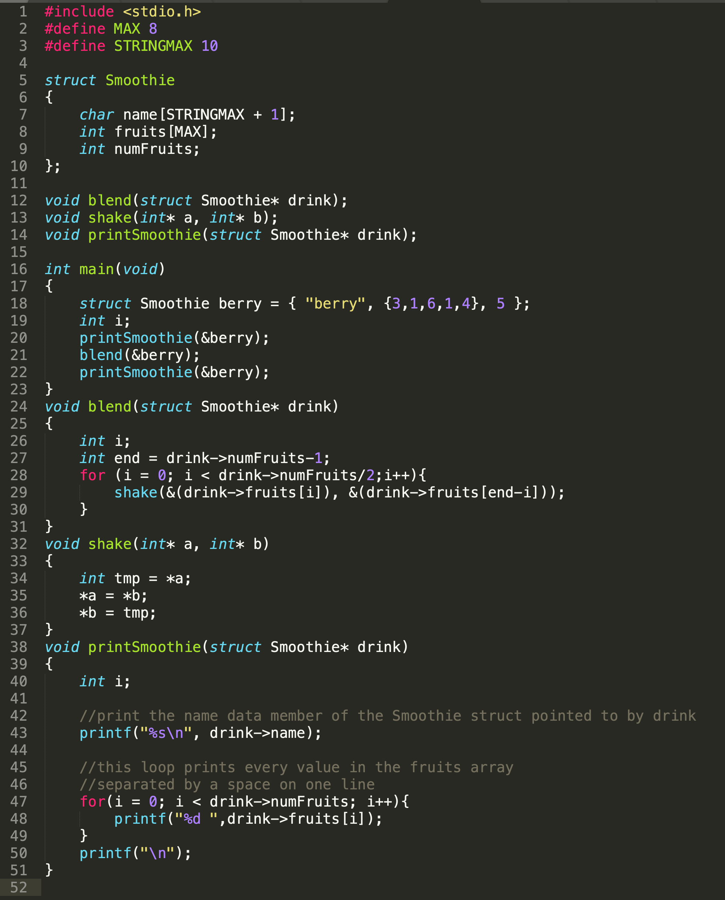

# Lab 6

This lab is worth 1.25% of your final grade

## Due Date: 

* End of lab class in week 9


## What you need to do (by the end of the lab class) 

* Quiz: Record your answers to the in-class quiz on the paper provided to you
* Walkthrough: Record your answer to the walkthrough on the paper provided  to you
* Code: Update your PRIVATE GitHub ipc144 repository:
	* With the solutions to the assigned lab work even if it is not fully functional or completed
	* Submit the code using matrix submitter
	* Submit the URL to your private ipc144 GitHub repository on Blackboard
 

## Objectives:

* practice writing/reading functions/programs that involves structs
* practice writing/reading functions/programs that involves pointers


## To have the best possible outcome for lab 6:

* Prior to lab, complete all the reading listed for week 8 and 9 in your Weekly Content item on blackboard. Please read the entire chapter.  Link repeated below
    * [Structs](https://seneca-scpa.github.io/Introduction-To-Programming/I-Structs/intro)
    * [Pointers](https://seneca-scpa.github.io/Introduction-To-Programming/J-PointersAndParameters/intro)


## Lab Preparation

To submit your work for this lab, **YOU MUST HAVE SUCCESSFULLY COMPLETED [Lab-0](../lab0/README.md)** where you configure the tooling and learn the process involved in completing a lab and how to submit your work!

---

## Quiz Part-1

```
   ___        _          ____            _        _ 
  / _ \ _   _(_)____    |  _ \ __ _ _ __| |_     / |
 | | | | | | | |_  /    | |_) / _` | '__| __|____| |
 | |_| | |_| | |/ /     |  __/ (_| | |  | ||_____| |
  \__\_\\__,_|_/___|    |_|   \__,_|_|   \__|    |_|
```

* Part-1 of the quiz is based on the reading material for weeks 8 and 9 (stucts and pointers)
* Your professor will provide you with a piece of paper and project the lab quiz on the lab screen.
* Provide the answer to the questions on your paper.  You only need to number the question and write down the answer.  No need to copy the question.

---

## Walkthrough

```
 __        __    _ _    _   _                           _     
 \ \      / /_ _| | | _| |_| |__  _ __ ___  _   _  __ _| |__  
  \ \ /\ / / _` | | |/ / __| '_ \| '__/ _ \| | | |/ _` | '_ \ 
   \ V  V / (_| | |   <| |_| | | | | | (_) | |_| | (_| | | | |
    \_/\_/ \__,_|_|_|\_\\__|_| |_|_|  \___/ \__,_|\__, |_| |_|
                                                  |___/       
  ____                                 _             _   _             
 |  _ \  ___ _ __ ___   ___  _ __  ___| |_ _ __ __ _| |_(_) ___  _ __  
 | | | |/ _ \ '_ ` _ \ / _ \| '_ \/ __| __| '__/ _` | __| |/ _ \| '_ \ 
 | |_| |  __/ | | | | | (_) | | | \__ \ |_| | | (_| | |_| | (_) | | | |
 |____/ \___|_| |_| |_|\___/|_| |_|___/\__|_|  \__,_|\__|_|\___/|_| |_|
                                                                       
```

Programs containing structs are tracked in a similar way as arrays.  Your table will require a column for each struct data member.

Your professor will:
- Demonstrate how to document your answer to a walkthrough containing structures
- Guide you through the walkthrough 
- **BE SURE TO RECORD YOUR ANSWER on your worksheet** as this will be **GRADED**



---

## Programming Problem Overview

In this lab you will write a currency exchange program.  You will define a struct to represent the related details of a currency. The program converts a user-entered amount either to or from Canadian dollars to another currency.

The program will:

- require the user to specify what type of conversion to perform (To-Canadian Dollars or From-Canadian Dollars).
- require the user to enter the amount to convert
- calculate the amount to the desired currency
- output the converted value
- additionally, when the exchange is converting To-Canadian dollars, the amount will be broken down into the quantities of each Canadian bill and coin denomination.

### Defining the Currency Structure

To solve this problem we want to represent a currency in a meaningful way using a `struct` to define a new data type tailored to our data requirements. The name of the structure must be called `Currency`. A `Currency` is represented by more than the exchange rate - it contains other important related attributes. Apply the below exact names for the structure members and in the same order:

- `iso` - a string with a max of 3 displayable characters.  These 3 characters store the ISO name for the currency.  For example Canadian dollars is CAD
- `rate` - a double, the amount of currency we can get with 1 Canadian Dollar
- `fullName` - the full name of the currency, a string with a max of 100 displayable characters

**NOTE:**
- The structure should be placed in the `lab6.h` file

### Function 1:

```c
void makeChange(int cents, int* quarters, int* dimes, int* nickels);
```

This function is passed **total cents** which is the amount of money we are making change for.  You may assume this number is between 0 and 97 inclusive (98 and 99 round up to $1 therefore we are not going to pass those values in). Your function will calculate the number of each coins needed to reach this amount (rounding up and down as needed).

In Canada, we have only 3 denominations of coins worth less than $1. They 
are:
- quarters (25 cent coin)
- dimes (10 cent coin)
- nickels (5 cent coin)

When giving change we **round to the nearest nickel**:
- **Round-Down**: When the ending cent digit is 1, 2, 6 or 7
- **Round-Up**: When the ending cent digit is 3, 4, 8 or 9

Thus, if the amount of change is 87 cents, we would round down to 85 cents in coins (3 quarters and 1 dime).  However, if the amount of change was 88 cents, we would round up to 90 cents in coins (3 quarters, 1 dime and one nickel).

More Examples:

```c
int quarters, dimes, nickels;
makeChange(86, &quarters, &dimes, &nickels);
//after the function call, quarters = 3, dimes = 1, nickels = 0

makeChange(89, &quarters, &dimes, &nickels);
//after the function call, quarters = 3, dimes = 1, nickels = 1
```

### Function 2:

```c
void getBills(int money, int* hundreds, int* fifties, int* twenties, int* tens,
											int* fives, int* toonies, int* loonies);
```

This function is given an amount of money and passes back the number of bills/coins needed to make up that amount of money.

Note: 
- a toonie is a two-dollar coin (because it rhymes with loonie but is worth (t)wo dollars)
- a loonie is a one-dollar coin (because there is bird (a loon) on it)

Examples:

```c
int hundreds, fifties, twenties, tens, fives, toonies, loonies;
getBills(15, &hundreds, &fifties, &twenties, &tens, &fives, &toonies, &loonies);
//after the function call, hundreds= 0, fifties=0, twenties=0, tens=1, fives=1, toonies = 0, loonies = 0

getBills(103, &hundreds, &fifties, &twenties, &tens, &fives, &toonies, &loonies);
//after the function call, hundreds= 1, fifties=0, twenties=0, tens=0, fives=0, toonies = 1, loonies = 1);
```

### Function 3:

This function is passed a `Currency` and the amount of money (in Canadian Dollars) to convert. It returns the converted amount of money using the exchange rate specified in `currency`.

```c
double fromCAD(const struct Currency* currency, double money);
```


### Function 4:

This function is passed a `Currency` and the amount of money (in a non-Canadian currency) to convert. It returns the converted amount of money to Canadian Dollars by applying the **reciprocal** of the exchange rate specified in `currency`.

```c
double toCAD(const struct Currency* currency, double money);
```

### Function 5:

This function is passed an amount of money represented as a double. It returns back the whole-number dollar part and whole-number cents part of the double amount through the respective dollarPart and centPart pointer parameters.

```c
void getDollarsAndCents(double money, int* dollarPart, int* centPart);
```

Example:

```c
int dollars, cents;
getDollarsAndCents(123.00, &dollars, &cents);
//after the function call, dollars = 123, cents = 0);

getDollarsAndCents(0.54, &dollars, &cents);
//after the function call, dollars = 0, cents = 54);

getDollarsAndCents(123.54, &dollars, &cents);
//after the function call, dollars = 123, cents = 54);

```

---

```
  ____                                 _             _   _             
 |  _ \  ___ _ __ ___   ___  _ __  ___| |_ _ __ __ _| |_(_) ___  _ __  
 | | | |/ _ \ '_ ` _ \ / _ \| '_ \/ __| __| '__/ _` | __| |/ _ \| '_ \ 
 | |_| |  __/ | | | | | (_) | | | \__ \ |_| | | (_| | |_| | (_) | | | |
 |____/ \___|_| |_| |_|\___/|_| |_|___/\__|_|  \__,_|\__|_|\___/|_| |_|
                                                                       
```

## Getting Started: Demo

Your professor will:

- Discuss the lab file organization and what parts to put into each file
- How to write Function-1: `makeChange(...)`
- How to test Function-1 calling it from the main function

---

```
  ___ _   _      __   __                 _____                         
 |_ _| |_( )___  \ \ / /__  _   _ _ __  |_   _|   _ _ __ _ __          
  | || __|// __|  \ V / _ \| | | | '__|   | || | | | '__| '_ \         
  | || |_  \__ \   | | (_) | |_| | |      | || |_| | |  | | | |  _ _ _ 
 |___|\__| |___/   |_|\___/ \__,_|_|      |_| \__,_|_|  |_| |_| (_|_|_)
                                                                       
```

## Program the Functions

Code all the remaining functions described above and test each one as you complete them. 

You have done this numerous times in previous labs.  To complete this lab, you will need to put the appropriate information into the correct file.

- **lab6.h** : STRUCTURE(s), Function PROTOTYPES with **DOCUMENTATION for each function**
- **lab6.c** : Function DEFINITIONS
- **lab6main.c** : 
    - **Testing**: Testing your function during the development of the solution
    - **Assembly**: Replace all testing code from your development phase with the program solution. This will assemble and implement those functions as required. See the next section.


---

## The program:

Your program will:

* Print this banner at start of program:
```
IPC Currency Exchange Machine
=============================
```
* Set up an instance of Currency for any non-Canadian currency you want.
* Use google to find the description, iso name and rate.
* Ask user if they wish to exchange from `<iso>` to CAD or vice versa.
	* Example, if you chose United States dollars then the iso name is USD and your menu would be:
	```
	1) exchange from USD to CAD
	2) exchange from CAD to USD
	Your choice (1 or 2): 
	```
	* Make sure you are not hardcoding your iso name into your output, use the instance of the Currency struct you created for this output.
	* The input must be validated using methods previously discussed.  If user enters invalid information, be sure to ask them to re-enter.
    	* the process of doing this has been done many times in the past.  You can look back to your previous labs on how to do this.  Ensure that user enters either a 1 or a 2
* Ask user to enter the amount of money
	```
	Enter amount: $
	```
* Perform the exchange as necessary
* Print one of the following depending on menu choice
	* If converting to CAD, make sure to list the number of each type of bills and coins for amount of money, one per line:
	```
	Converting <currency-fullName> to Canadian Dollars
	$<user-input-amount> <currency-iso> is $<converted-amount> CAD
	
	Hundreds: <#>
	Fifties : <#>
	Twenties: <#>
	etc...
	```
	* or if converting from CAD only print the amount of money with the iso currency and currency description
	```
	Converting Canadian Dollars to <description>
	<user input> CAD is <amount of money> <currency iso>
	```
* End the program with an exit message:
   ```
   Have a good day!
   ```

### Sample Run 1:

NOTE: This example uses the USD conversion rate of 0.71

```
IPC Currency Exchange Machine
=============================
1) exchange from USD to CAD
2) exchange from CAD to USD
Your choice (1 or 2): 3
That was not a valid option
Your choice (1 or 2): 2

Enter Amount: $10.00

Converting Canadian Dollars to United States Dollars
$10.00 CAD is $7.10 USD

Traveller's cheque has been dispensed.

Have a good day!
```

### Sample Run 2:

NOTE: This example uses the USD conversion rate of 0.71

```
IPC Currency Exchange Machine
=============================
1) exchange from USD to CAD
2) exchange from CAD to USD
Your choice (1 or 2): 1

Enter Amount: $10.00

Converting United States Dollars to Canadian Dollars
$10.00 USD is $14.08 CAD

Your money has been dispensed in the following denominations:

Hundreds: 0
Fifties : 0
Twenties: 0
Tens    : 1
Fives   : 0
Toonies : 2
Loonies : 0
Quarters: 0
Dimes   : 1
Nickels : 0

Have a good day!
```

---


## Submission Instructions:

```
  ____        _               _         _             
 / ___| _   _| |__  _ __ ___ (_)___ ___(_) ___  _ __  
 \___ \| | | | '_ \| '_ ` _ \| / __/ __| |/ _ \| '_ \ 
  ___) | |_| | |_) | | | | | | \__ \__ \ | (_) | | | |
 |____/ \__,_|_.__/|_| |_| |_|_|___/___/_|\___/|_| |_|
                                                      
```

* Submit your code (solution to the programming problem)

	- Update your GitHub PRIVATE ipc144 repository with your solution to the programming problem:
		- Here is an EASY [guide on how to push code from Visual Studio Code and Visual Studio](../gitinstructions/gitpush.md)
		- If you are not using the above IDE's, manually perform the 3-git commands (from anywhere within your repository directory structure):
			```
			git add -A
			git commit -am "Completed lab6"
			git push origin main
			```

	- Connect to **matrix**: 
		- Open a command prompt (or terminal) window
		- Type the following connection command and substitute `loginName` with YOUR Seneca login name!
		```
		SSH loginName@matrix.senecapolytechnic.ca
		```
	- Change to the directory where you cloned your ipc144 repository (use the `cd` command accordingly)
	- Update the matrix copy of your PRIVATE ipc144 GitHub repository:
		```
		git pull origin main
		```
	- Change to the `lab6` directory (inside your ipc144 repository):
		```
		cd lab6
		```
	- Submit your code using the submitter. Substitute `professor.name` with your professor\'s account name, and `NQQ` with your course section code:
		```
		~professor.name/submit 144lab6/lab6-NQQ
		```
	- Follow the directions to submit your code.

		- **IMPORTANT**: Your application will be compiled and executed by the submitter. It will be an interactive session meaning it will require you to provide the necessary user input(s) to demonstrate your program works (use the values stated by the submitter).

	- If there are errors or your submission failed to submit, fix the problems **ON YOUR DEVICE**, and repeat the above submission process again from the beginning.
	
 * Lastly, on **Blackboard** paste the URL (link) to the **lab6** directory of your PRIVATE ipc144 GitHub repository by clicking the `Lab-6` assignment under the **Labs** section of your repository.

> [!IMPORTANT]
>
> **DO NOT modify your code directly from matrix** as this will put your repository out of sync
> with the copy of your code on GitHub (unless you push the changes and pull it from all other devices afterwards).
>
> You will learn how to use Git and GitHub properly in your CEP146 course.

> [!CAUTION]	
>
> **Only submissions done from matrix will be accepted and eligible for marks**, see the grading rubrics section.
> 

---

```
   ___        _          ____            _       ____  
  / _ \ _   _(_)____    |  _ \ __ _ _ __| |_    |___ \ 
 | | | | | | | |_  /    | |_) / _` | '__| __|____ __) |
 | |_| | |_| | |/ /     |  __/ (_| | |  | ||_____/ __/ 
  \__\_\\__,_|_/___|    |_|   \__,_|_|   \__|   |_____|
                                                       
```

## Quiz Part-2

* Part-2 of quiz is based on what you did during the lab.
* Provide the answer to the questions on your paper.  You only need to number the question and write down the answer.
* Do NOT copy the question!

---

```
   ____               _ _                  ____        _          _      
  / ___|_ __ __ _  __| (_)_ __   __ _     |  _ \ _   _| |__  _ __(_) ___ 
 | |  _| '__/ _` |/ _` | | '_ \ / _` |    | |_) | | | | '_ \| '__| |/ __|
 | |_| | | | (_| | (_| | | | | | (_| |    |  _ <| |_| | |_) | |  | | (__ 
  \____|_|  \__,_|\__,_|_|_| |_|\__, |    |_| \_\\__,_|_.__/|_|  |_|\___|
                                |___/                                    
```

## Rubric Details:

To be eligible for **FULL MARKS**, you will need to satisfy the following:
 
* Score a minimum 50% on the combined questions from the quiz (parts 1 and 2 combined)
* Answers to the walkthrough are written on the provided lab sheet
* Code must be pushed (updated) back into your PRIVATE **ipc144** GitHub repository
* Code must be **submitted by the matrix submitter**
* Code must **solve the problem and address all the lab specifications**
* Pasted the **URL to your PRIVATE ipc144 repository's this lab's directory on GitHub** into **Blackboard**

### Rubric Description

> [!WARNING]
> 
> In class participation is mandatory to receive any marks for the lab:
> * If you are not in class, you will get **0 marks even if you submit the code for the lab.**
> * You must have participated in BOTH parts of the in-lab quiz (with submitted answers on lab sheet)
> * You must have provided a walkthrough answer on the provided lab sheet


| Grade | Description|
| ----- | -----------|
| **Unsatisfactory** | 1. Scored 33% or less on the quiz `OR` <br> 2. Code was not submitted using the **matrix submitter** \(must also include the **link submission on Blackboard**\) `OR` <br>3. Did not PUSH at least 50% of the lab code working solution to your PRIVATE GitHub repository before end of lab period |
| **Incomplete** | 1.  Scored more than 33% on the quiz `AND` <br>2. Code was submitted with the **matrix submitter** and **link posted on Blackboard** `AND` <br>3. Repository was updated with a working 50% or more of the solution by the end of class but does not yield a complete solution to the problem \(does not work as it should or is incomplete\)|
| **Satisfactory** |1. Scored 50% or better on the quiz `AND`<br> 2.Code was submitted with the **matrix submitter** and **link posted on Blackboard** `AND` <br>3. Repository was updated by end of the lab `AND`<br> 4. Coded solution **solves the problem and addresses all the lab specifications** \(if a tester is used, it  score 100% pass rate\)|


### Rubric

|  | Level: 0 | Level: 1 | Level: 2 |
| -------- | ------- | ------- | ------- |
| **Grade** | `0.0` | `0.5` | `1.0` |
| **Description** | Unsatisfactory | Incomplete | Satisfactory |

---

```
  _____      _                ____                 _   _          
 | ____|_  _| |_ _ __ __ _   |  _ \ _ __ __ _  ___| |_(_) ___ ___ 
 |  _| \ \/ / __| '__/ _` |  | |_) | '__/ _` |/ __| __| |/ __/ _ \
 | |___ >  <| |_| | | (_| |  |  __/| | | (_| | (__| |_| | (_|  __/
 |_____/_/\_\\__|_|  \__,_|  |_|   |_|  \__,_|\___|\__|_|\___\___|
                                                                 
```

## Extra Practice:


### DateTime Struct

Some of the functions below work with the DateTime Struct:

```c
struct DateTime
{
	int day;
	int month;
	int year;
	int hour;
	int minute;
};
```
* day is the day of the month (1 to 31)
* month is the month of the year (1 to 12)
* year is the year
* hour is the hour component of time on the 24 hour clock
* minute is the minute component of the time

## Extra Practice 1:


Write the following function:
```c
void setTime(const char timeString[], struct DateTime* dt);
```

This function is passed **timeString** which is a string in the form 
hh:mm. You may assume the string is always this format.  The function 
will extract the hour and minutes from **timeString** and store this 
information as integers into the DateTime struct pointed at by **dt**


## Extra Practice 2


```c
void countCharacters(const char str[], int* numAlpha, int* numDigits);
```

This function is passed a null terminated character string.  It will pass 
back the number of alphabetic characters (either upper or lower case) 
through numAlpha, and the number of numeric characters through numDigits. 
 Function does not return anything.


## Extra Practice 3:


```c
void minMaxAverage(int array[],int size, int* minIdx, int* maxIdx, 
double* average);
```

This function finds and passes back:
* index of the smallest value in the array through minIdx.  In the case 
of a tie, pass back the index of the first of the smallest index
* index of the largest value in the array through maxIdx.  In the case of 
a tie, pass back the index of the last of the largest index
* average of the values in the array


### Extra Practice 4:

Write the following function:

```c
void setDate(const char dateString[], struct DateTime* dt);
```

This function is passed **dateString** which is in the form dd/mm/yyyy.  You may assume the string is always this format.  The function will extract the day, month and year from **dateString** and store the information as integers into the DateTime struct pointed at by **dt**.


