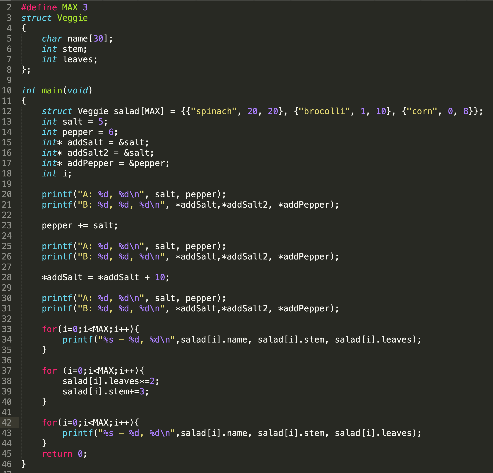

# Lab 7

This lab is worth 1.25% of your final grade

## Due Date: 

* End of lab class in week 9


## What you need to do (by the end of the lab class) 

* Quiz: Record your answers to the in-class quiz on the paper provided to you
* Code: Update your PRIVATE GitHub ipc144 repository:
	* With the solutions to the assigned lab work even if it is not fully functional or completed
	* Submit the code using matrix submitter
	* Submit the URL to your private ipc144 GitHub repository on Blackboard


## Objectives:

* Practice writing/reading functions/programs that involves complex types including composition and aggregation.


## To have the best possible outcome for lab 7:

* Prior to lab, complete all the reading listed for week 10 in your Weekly Content item on blackboard. Please read the entire chapter.  Link repeated below
    * [Complex Aggregate Types](https://seneca-scpa.github.io/Introduction-To-Programming/K-ComplexAggregateTypes/intro)


## Lab Preparation

To submit your work for this lab, **YOU MUST HAVE SUCCESSFULLY COMPLETED [Lab-0](../lab0/README.md)** where you configure the tooling and learn the process involved in completing a lab and how to submit your work!


## Quiz Part-1

```
   ___        _          ____            _        _ 
  / _ \ _   _(_)____    |  _ \ __ _ _ __| |_     / |
 | | | | | | | |_  /    | |_) / _` | '__| __|____| |
 | |_| | |_| | |/ /     |  __/ (_| | |  | ||_____| |
  \__\_\\__,_|_/___|    |_|   \__,_|_|   \__|    |_|
```

* Part-1 of quiz is based on the reading material for week 10 (Complex Aggregate Types)
* Your professor will provide you with a piece of paper and project the lab quiz on the lab screen.
* Provide the answer to the questions on your paper.  You only need to number the question and write down the answer.  No need to copy the question.

---


## Programming Problem Overview

This lab extends [Lab 6](../lab6/README.md), adding more data management and features. You will be writing an application to track activity (transactions) for one or more Currency Exchange Kiosk(s).  The application will involve some complex types constructed with composition and aggregation along with various functions using these `struct` types.


### Program Outline

Several new `struct` types and `functions` will be created and used (all of which are described after this section) to help create your program solution. 

> [!NOTE]
> - All cases where data entry is required, basic input validation must be implemented (range checking).
> - You are welcome and encouraged to add additional functions to help you handle the input/output and menus required by the main program.
> - This exercise is good practice in breaking down a problem into several simpler tasks.

Below is a general overview of the program construction and features:

1. Create a menu driven program as follows:

	* Print a starting banner at start of program:

	```
	IPC Currency Exchange Application
	=================================
	```

	* Print the following main menu and ask user for choice:

	```
	1. Use Kiosk 1
	2. Use Kiosk 2
	3. Add Currency to Kiosk 1
	4. Add Currency to Kiosk 2
	5. Display Kiosk Information
	6. Exit
    Please enter your choice: 
	```

2. The application will initially start with two `ExchangeKiosk` type variables initialized with the following information:

	* Kiosk-1:
		* id - 12345
		* USD (United States Dollar) - exchange rate of 0.73
		* MXN (Mexican Peso) - exchange rate of 12.93
		* commission of 1%

	* Kiosk-2:
		* id - 54321
		* EUR - (Euro) - exchange rate 0.64
		* commission of 1.5%

	* A kiosk can support exchanges for several currencies and for each currency available, a corresponding `Statistic` type element is required and must be initialized with 0 values

	* Initialize profit to 0 for both kiosks

3. If the user chooses to **Use Kiosk** \[1|2\]: 

   * Create the following sub menu:

		```
		Which Currency Would you like to exchange?
		1. <currency 1>
		2. <currency 2>
		3. ...
		Please enter your choice:
		```

		**Note**: the listed items should be in the format: `<menu-option-number>. <iso>: <fullName>`

   * After choice is entered, ask user if they would like to exchange from CAD or to CAD from the currency chosen

		```
		1. exchange from <iso> to CAD
		2. exchange from CAD to <iso>
		Your choice (1 or 2): 
		```

   * After asking from/to, ask for the amount of money they wish to exchange:

		```
		Enter amount: $ 
		```

   * Update the ExchangeKiosk with the information provided

       * Update the associated Stats object based on user's choice
       * Update the commission earned.  The commission earned is based on the commission rate applied to the amount of Canadian dollars in the transaction
       * Print out the result

		```
		Converting <currency-fullName> to Canadian Dollars
		$<user-input-amount> <currency-iso> is $<converted-amount> CAD
		Commission: $<commission amount> CAD
		```

	    OR:
    
		```
		Converting Canadian Dollars to <currency-fullName>
		$<user input> CAD is $<converted-amount> <currency-iso>
		Commission: $<commission amount> CAD
		```

   * Return to the main menu for further processing

4. If the user chooses to **Add Currency to Kiosk** \[1|2\]:
	
	* Ask user to enter the details for the new currency:
		* iso
		* full name of currency
		* rate
	
	* Add the new `Currency` to the chosen kiosk, updating all the necessary data members
	
	* Return to the main menu for further processing


5. If the user chooses to **Display Kiosk Information**, print out the basic information about the two Kiosks:

	```
	Kiosk #12345 - 1% commission
	Available Currencies:
	1. <currency 1>
	2. <currency 2>
	3. ...

	Kiosk #54321 - 1.5% commission
	Available Currencies:
	1. <currency 1>
	2. <currency 2>
	3. ...
	```

	- **Note**: the listed items should be in the format: `<menu-option-number>. <iso>: <fullName>`

    * Return to the main menu for further processing

7. If the user chooses to **Exit** the program, for each kiosk print an end of day report which includes:

    * the total amount of commission earned
    * statistical report (see printStats() function below for details)

    ```
    End of Day Report
    =================
    Kiosk # <kiosk number>
    Commission Earned: <profit>

    Transaction Summary:
    ====================
    Currency - Number of Transactions: From CAD; To CAD
    <contents of report>
    ```


### Structs

Define all structs in `lab7.h` using the exact type names, member names, and order as described below:  

#### **Currency** Struct

The **Currency** struct was previously defined in Lab 6 and has the same requirements for this lab having the following members:

|Member | Description |
|------ | ----------- |
`iso` | a C string with a max of 3 displayable characters.  These 3 characters store the ISO name for the currency.  For example Canadian dollars is CAD
`rate` | a double, the amount of currency we can get with 1 Canadian Dollar
`fullName` | a C string with a max of 100 displayable characters for the full name of the currency


#### **Statistics** Struct

The **Statistics** struct keeps track of the number of times a currency was exchanged and the amount of money exchanged **to** and **from** Canadian dollars.

|Member | Description |
|------ | ----------- |
`numTransactions` | an integer value representing the **number of transactions** involving a particular currency
`toCAD` | a double representing the **total amount** of money transferred **to** Canadian dollars from this currency
`fromCAD` | a double representing the **total amount** of money transferred **from** Canadian dollars. NOTE: this total uses the CAD value only NOT the conversion to the other currency.

#### **ExchangeKiosk** Struct

The **ExchangeKiosk** struct keeps track of information about a kiosk.  Each ExchangeKiosk struct has the following information:

|Member | Description |
|------ | ----------- |
`storeID` | an integer representing the unique identifier for a store (what store owns the kiosk)
`currencies` | An array of `Currency` structs (**capacity of 20**)
`stats` | An array of `Statistics` structs that is a parallel array to **currencies** that keeps track of the number and amount of the transactions for the corresponding currency(**capacity of 20**)
`numCurrency` | an integer representing the number of currencies the kiosk can exchange (integer)
`commission` | a double representing the percentage the store charges each customer for performing an exchange.  For example 1% is stored as 0.01
`profit` | a double representing the kiosk's amount of profit earned

---

### Functions

The decomposition process is key to working on larger more complex problems. The above program may seem really complicated but is actually quite manageable after breaking it down into several smaller functions. The assembly of the complete solution for this program will require calling these functions as needed. Again, you may wish to add additional functions to your program to make it easier to perform repetitious tasks or to simplify your function(s) so they are more readable (to make it less congested if it contains too much code).


#### Function 1:

```c
double fromCAD(const struct Currency* currency, double money);
```

!!! **This function does not get user input or display anything to the screen** !!!

This function is passed a Currency and the amount of money (in Canadian Dollars) and returns the amount of money using the exchange rate specified in currency.

> [!TIP]
> This function was been done in **[Lab 6](../lab6/README.md)**: Copy it into this lab!

#### Function 2:

```c
double toCAD(const struct Currency* currency, double money);
```

!!! **This function does not get user input or display anything to the screen** !!!

This function is passed a Currency the amount of money (in a foreign currency) and returns the amount of money in Canadian Dollars.

> [!TIP]
> This function was been done in **[Lab 6](../lab6/README.md)**: Copy it into this lab!

#### Function 3:

```c
void displayKioskInfo(const struct ExchangeKiosk* kiosk);
```

This function displays basic information about the kiosk. It will require showing the full name for all the currencies the kiosk supports:

```text
Kiosk #<id> - <commissionRate>% commission
Available Currencies:
1. <currency 1>
2. <currency 2>
3. ... 
```

**Note**: Each numbered menu item currency is in the format: [`menu option #`]. [`iso`] ([`fullName`])

#### Function 4:

```c
int addCurrency(struct ExchangeKiosk* kiosk, const struct Currency* newCurrency);
```

!!! **This function does not get user input or display anything to the screen** !!!

This function adds a copy of the `newCurrency` to the `kiosk` currency listing (if there is space in the array to do so).  

If the kiosk is already at the maximum number of currencies it can manage, the newCurrency is **not added**.

Remember, each currency requires a related `Statistics` entry in the kiosk and should be starting with 0 values for every data member. 

This function returns the number of active Currency structs supported by the kiosk.

#### Function 5:

```c
int handleTransaction(struct ExchangeKiosk* kiosk, int currencyIdx, int isToCAD, double amount);
```

This function updates the kiosk data based on the details of the transaction:
* `currencyIdx`: the `kiosk`'s currency index to use for the currency exchange transaction
* `isToCAD`: The exchange transaction direction (**1=TO** Canadian dollars, **0=FROM** Canadian dollars)
* `amount`: The amount of money to exchange

When the **currencyIdx** is within the kiosk's **active** currency range:
* update the associated `Statistic` for the transaction
* update the kiosk **profit** (NOTE: Commission is ALWAYS calculated based on the CAD amount)
* Display the results of the transaction based on FROM or TO CAD:

	- TO CAD:
		```
		Converting <currency-fullName> to Canadian Dollars
		$<user-input-amount> <currency-iso> is $<converted-amount> CAD
		Commission: $<commission amount> CAD
		```
    
	- FROM CAD:
		```
		Converting Canadian Dollars to <currency-fullName>
		$<user input> CAD is $<converted-amount> <currency-iso>
		Commission: $<commission amount> CAD
		```

* **return 1** from the function

Otherwise, if the currencyIdx does **NOT** reference an **active** currency:
* Don't modify the kiosk data (leave it unaltered)
* **return 0** from the function


#### Function 6:

```c
void printStats(const struct ExchangeKiosk* kiosk);
```

* print out one per line the currency iso, the number of transactions, the amount of money exchange from/to CAD to/from the currency.

HINT: remember the currencies and stats arrays are parallel

```
<iso> - <number of transactions>: $<CAD to currency>; $<CAD from currency>
```

---


```
  ____                                 _             _   _             
 |  _ \  ___ _ __ ___   ___  _ __  ___| |_ _ __ __ _| |_(_) ___  _ __  
 | | | |/ _ \ '_ ` _ \ / _ \| '_ \/ __| __| '__/ _` | __| |/ _ \| '_ \ 
 | |_| |  __/ | | | | | (_) | | | \__ \ |_| | | (_| | |_| | (_) | | | |
 |____/ \___|_| |_| |_|\___/|_| |_|___/\__|_|  \__,_|\__|_|\___/|_| |_|
                                                                       
```

## Getting Started: Demo

Your professor will demonstrate:

* How to define the `Currency` structure.

* How to get started defining the `ExchangeKiosk` structure (data members for `storeID` and `currencies`.  You will be responsible for the rest).

* How you would create a variable instance of `ExchangeKiosk` in your `main` function initialized with the data for **Kiosk-1** (described above in the **Program Outline** section point number 2).

* How to **call** the `toCAD()` function using the kiosk-1 variable's MXN currency.

---

```
  ___ _   _      __   __                 _____                         
 |_ _| |_( )___  \ \ / /__  _   _ _ __  |_   _|   _ _ __ _ __          
  | || __|// __|  \ V / _ \| | | | '__|   | || | | | '__| '_ \         
  | || |_  \__ \   | | (_) | |_| | |      | || |_| | |  | | | |  _ _ _ 
 |___|\__| |___/   |_|\___/ \__,_|_|      |_| \__,_|_|  |_| |_| (_|_|_)
                                                                       
```

## Program the Functions

Code all the remaining functions described above and test each one as you complete them. 

You have done this numerous times in previous labs.  To complete this lab, you will need to put the appropriate information into the correct file.

- **lab7.h** : STRUCTURE(s), Function PROTOTYPES with **DOCUMENTATION for each function**
- **lab7.c** : Function DEFINITIONS
- **lab7main.c** : 
    - **Testing**: Testing your function during the development of the solution
    - **Assembly**: Replace all testing code from your development phase with the program solution. This will assemble and implement those functions as required. Refer to the program outline section for the application features and menu operations.

---


## Submission Instructions:

```
  ____        _               _         _             
 / ___| _   _| |__  _ __ ___ (_)___ ___(_) ___  _ __  
 \___ \| | | | '_ \| '_ ` _ \| / __/ __| |/ _ \| '_ \ 
  ___) | |_| | |_) | | | | | | \__ \__ \ | (_) | | | |
 |____/ \__,_|_.__/|_| |_| |_|_|___/___/_|\___/|_| |_|
                                                      
```

* Submit your code (solution to the programming problem)

	- Update your GitHub PRIVATE ipc144 repository with your solution to the programming problem:
		- Here is an EASY [guide on how to push code from Visual Studio Code and Visual Studio](../gitinstructions/gitpush.md)
		- If you are not using the above IDE's, manually perform the 3-git commands (from anywhere within your repository directory structure):
			```
			git add -A
			git commit -am "Completed lab6"
			git push origin main
			```

	- Connect to **matrix**: 
		- Open a command prompt (or terminal) window
		- Type the following connection command and substitute `loginName` with YOUR Seneca login name!
		```
		SSH loginName@matrix.senecapolytechnic.ca
		```
	- Change to the directory where you cloned your ipc144 repository (use the `cd` command accordingly)
	- Update the matrix copy of your PRIVATE ipc144 GitHub repository:
		```
		git pull origin main
		```
	- Change to the `lab7` directory (inside your ipc144 repository):
		```
		cd lab6
		```
	- Submit your code using the submitter. Substitute `professor.name` with your professor\'s account name, and `NQQ` with your course section code:
		```
		~professor.name/submit 144lab7/lab7-NQQ
		```
	- Follow the directions to submit your code.

		- **IMPORTANT**: Your application will be compiled and executed by the submitter. It will be an interactive session meaning it will require you to provide the necessary user input(s) to demonstrate your program works (use the values stated by the submitter).

	- If there are errors or your submission failed to submit, fix the problems **ON YOUR DEVICE**, and repeat the above submission process again from the beginning.
	
 * Lastly, on **Blackboard** paste the URL (link) to the **lab7** directory of your PRIVATE ipc144 GitHub repository by clicking the `Lab-7` assignment under the **Labs** section of your repository.

> [!IMPORTANT]
>
> **DO NOT modify your code directly from matrix** as this will put your repository out of sync
> with the copy of your code on GitHub (unless you push the changes and pull it from all other devices afterwards).
>
> You will learn how to use Git and GitHub properly in your CEP146 course.

> [!CAUTION]	
>
> **Only submissions done from matrix will be accepted and eligible for marks**, see the grading rubrics section.
> 

---

```
   ___        _          ____            _       ____  
  / _ \ _   _(_)____    |  _ \ __ _ _ __| |_    |___ \ 
 | | | | | | | |_  /    | |_) / _` | '__| __|____ __) |
 | |_| | |_| | |/ /     |  __/ (_| | |  | ||_____/ __/ 
  \__\_\\__,_|_/___|    |_|   \__,_|_|   \__|   |_____|
                                                       
```

## Quiz Part-2

* Part-2 of quiz is based on what you did during the lab.
* Provide the answer to the questions on your paper.  You only need to number the question and write down the answer.
* Do NOT copy the question!

---


```
   ____               _ _                  ____        _          _      
  / ___|_ __ __ _  __| (_)_ __   __ _     |  _ \ _   _| |__  _ __(_) ___ 
 | |  _| '__/ _` |/ _` | | '_ \ / _` |    | |_) | | | | '_ \| '__| |/ __|
 | |_| | | | (_| | (_| | | | | | (_| |    |  _ <| |_| | |_) | |  | | (__ 
  \____|_|  \__,_|\__,_|_|_| |_|\__, |    |_| \_\\__,_|_.__/|_|  |_|\___|
                                |___/                                    
```

## Rubric Details:

To be eligible for **FULL MARKS**, you will need to satisfy the following:
 
* Score a minimum 50% on the combined questions from the quiz (parts 1 and 2 combined)
* Code must be pushed (updated) back into your PRIVATE **ipc144** GitHub repository
* Code must be **submitted by the matrix submitter**
* Code must **solve the problem and address all the lab specifications**
* Pasted the **URL to your PRIVATE ipc144 repository's this lab's directory on GitHub** into **Blackboard**

### Rubric Description

> [!WARNING]
> 
> In class participation is mandatory to receive any marks for the lab:
> * If you are not in class, you will get **0 marks even if you submit the code for the lab.**
> * You must have participated in BOTH parts of the in-lab quiz (with submitted answers on lab sheet)
> * You must have provided a walkthrough answer on the provided lab sheet


| Grade | Description|
| ----- | -----------|
| **Unsatisfactory** | 1. Scored 33% or less on the quiz `OR` <br> 2. Code was not submitted using the **matrix submitter** \(must also include the **link submission on Blackboard**\) `OR` <br>3. Did not PUSH at least 50% of the lab code working solution to your PRIVATE GitHub repository before end of lab period |
| **Incomplete** | 1.  Scored more than 33% on the quiz `AND` <br>2. Code was submitted with the **matrix submitter** and **link posted on Blackboard** `AND` <br>3. Repository was updated with a working 50% or more of the solution by the end of class but does not yield a complete solution to the problem \(does not work as it should or is incomplete\)|
| **Satisfactory** |1. Scored 50% or better on the quiz `AND`<br> 2.Code was submitted with the **matrix submitter** and **link posted on Blackboard** `AND` <br>3. Repository was updated by end of the lab `AND`<br> 4. Coded solution **solves the problem and addresses all the lab specifications** \(if a tester is used, it  score 100% pass rate\)|


### Rubric

|  | Level: 0 | Level: 1 | Level: 2 |
| -------- | ------- | ------- | ------- |
| **Grade** | `0.0` | `0.5` | `1.0` |
| **Description** | Unsatisfactory | Incomplete | Satisfactory |

---

```
  _____      _                ____                 _   _          
 | ____|_  _| |_ _ __ __ _   |  _ \ _ __ __ _  ___| |_(_) ___ ___ 
 |  _| \ \/ / __| '__/ _` |  | |_) | '__/ _` |/ __| __| |/ __/ _ \
 | |___ >  <| |_| | | (_| |  |  __/| | | (_| | (__| |_| | (_|  __/
 |_____/_/\_\\__|_|  \__,_|  |_|   |_|  \__,_|\___|\__|_|\___\___|
                                                                 
```

## Extra Practice:

### Walkthrough:

What is the output of the following program?



### Function 1:

Given the following struct definition:

```c
struct Date
{
	int day;
	int month;
	int year;
};
```


Write the following function:
```c
int findDate(int day, int month, int year, struct Date dates[],int size);
```

This function is passed a day, month and year representing a date that we are looking for.  It is also passed an array of Date structs and the size of that array. It will look for a match within the Date array (all 3 numbers have to match in order for the function to be considered a match).  The function returns index of the element with a matching date or -1 if none is found.  You may assume the dates are unique


### Function 2:

Given the following struct definition:

```c
struct Date
{
	int day;
	int month;
	int year;
};
```

Write the following function:
```c
int numInYear(int year, struct Date dates[], int size);
```
This function returns the number of dates that match the year


### Function 3:

Given the following struct definition


```c
struct Date
{
	int day;
	int month;
	int year;
};
```
Write the following function:
```c
int cmpDates(int dayIndex1, int dayIndex2, struct Date dates[]);
```
This function is passed an array and two numbers representing indexes to dates array. You may assume that dayIndex1 and dayIndex2 are both valid elements.

This function returns:

```
0 if dates[dayIndex1] is the same date as dates[dayIndex2]
1 if dates[dayIndex1] is earlier than dates[dayIndex2]
-1 if dates[dayIndex1] is later than dates[dayIndex2]
```


### Function 4:

Given the following struct definition:

```c
struct Date
{
	int day;
	int month;
	int year;
};
```

Write the following function:
```c
int printDates(struct Date dates[], int size)
```
This function is passed an array of Date structs and the size of the array.  It will print the dates stored in the array in the following format.  This will be printed one date per line:

monthname day, year

For example, if the Date array had 3 dates:
```c
struct Date dates[3]={{1,1,2024}, {2,9,2023}, {24, 11, 2024}};
```
the function would print:
```
January 1, 2024
September 2, 2023
November 24, 2024
```


